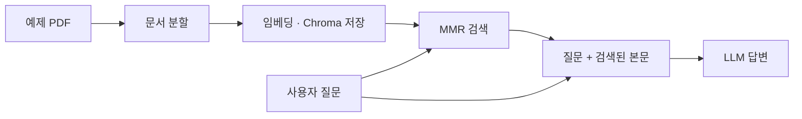

# RAG Camp

**문서에서 근거를 찾고, 도구를 선택하고, 다음 작업으로 분기하는 LLM 실험 노트북**

Python · JupyterLab · LangChain · Chroma · LangGraph

PDF 질의응답을 출발점으로, 검색 결과가 프롬프트에 들어가는 과정부터 모델이 도구를 호출하고 상태에 따라 실행 경로를 선택하는 과정까지 구현했습니다. 각 단계는 독립적인 노트북으로 살펴볼 수 있습니다.

[대표 실험](#대표-실험) · [학습 경로](#학습-경로) · [로컬 실행](#로컬-실행)

---

## 대표 실험

| 노트북 | 구현 내용 | 먼저 볼 부분 |
| :--- | :--- | :--- |
| [PDF 질의응답](02-RAG/13-RAG_final.ipynb) | 저장된 Chroma 인덱스에서 MMR로 문서 조각을 고르고 프롬프트에 전달합니다. | 검색된 조각의 메타데이터와 모델에 전달되는 본문 |
| [복수 도구 선택](04-Agent/02-multiple_tools.ipynb) | 전화번호 조회와 날씨 조회 예제 함수를 등록하고 질문에 맞는 도구를 선택하게 합니다. | 도구 정의와 에이전트 호출 셀 |
| [리뷰 응답 라우팅](05-Graph/09-routing.ipynb) | 리뷰 감정을 분류하고 긍정·부정·중립 응답 노드로 분기합니다. | `add_conditional_edges`와 세 가지 입력의 저장된 결과 |

### PDF 질의응답 흐름

> 예제 질문 · “노아의 홍수는 진짜 있었던 일인가요?”



[인덱스 생성 노트북](02-RAG/12-vector_store_persist.ipynb)에서 문서 조각을 저장하고, [질의응답 노트북](02-RAG/13-RAG_final.ipynb)에서 인덱스를 다시 엽니다. 예제는 후보 5개 중 1개의 조각을 골라 답변에 사용합니다. 검색 단계의 동작부터 보고 싶다면 [수동 RAG](02-RAG/09-manual_RAG.ipynb)에서 코사인 유사도로 문맥을 선택하는 셀을 먼저 살펴보세요.

## 학습 경로

| 폴더 | 다루는 내용 | 추천 시작점 |
| :--- | :--- | :--- |
| [`01/`](01/) | 모델 호출, 스트리밍, 프롬프트, LCEL, 구조화 출력 | [구조화 출력](01/01-Basics/10-structured_output.ipynb) |
| [`02-RAG/`](02-RAG/) | PDF·웹 문서 로딩, 청킹, 임베딩 모델별 유사도, Chroma 검색과 저장 | [수동 RAG](02-RAG/09-manual_RAG.ipynb) |
| [`03-Misc/`](03-Misc/) | 이미지 입력, LangSmith 추적, 쿼리 확장, 체인 합성 | [MultiQueryRetriever](03-Misc/04-MultiQueryRetriever.ipynb) |
| [`04-Agent/`](04-Agent/) | 단일 도구 호출에서 복수 도구 선택으로 확장 | [단일 도구 호출](04-Agent/01-tool_calling_agent.ipynb) |
| [`05-Graph/`](05-Graph/) | 상태와 메시지 관리, 병렬 실행, 조건부 분기 | [기본 StateGraph](05-Graph/01-simple_graph.ipynb) |

## 로컬 실행

루트 폴더에서 Python 3.12 환경을 준비합니다.

```bash
python3.12 -m venv .venv
source .venv/bin/activate
python -m pip install -r 01/requirements.txt
```

모델을 호출하는 실습은 루트의 로컬 `.env`에 필요한 키를 설정합니다. OpenAI 실습에는 `OPENAI_API_KEY`, Upstage 임베딩 비교에는 `UPSTAGE_API_KEY`, LangSmith 실습에는 `LANGSMITH_API_KEY`를 사용합니다. 공개 저장소에는 실제 키가 담긴 `.env`를 제외하세요.

```bash
python -m jupyterlab
```

- **API 키 없이 시작** · [기본 StateGraph](05-Graph/01-simple_graph.ipynb)를 열어 상태가 노드를 거치며 갱신되는 과정을 확인합니다.
- **PDF 질의응답 실행** · [최종 RAG](02-RAG/13-RAG_final.ipynb)를 엽니다. `./chroma_db`와 `./data`는 `02-RAG/` 기준 상대 경로이며, 인덱스가 없다면 [인덱스 생성 노트북](02-RAG/12-vector_store_persist.ipynb)을 먼저 실행합니다.
- **모델 접근 확인** · 모델 호출 셀은 계정에서 접근 가능한 모델이 필요합니다. 모델 접근 오류가 나면 해당 셀의 모델 ID를 계정에서 사용할 수 있는 모델로 바꿉니다.
